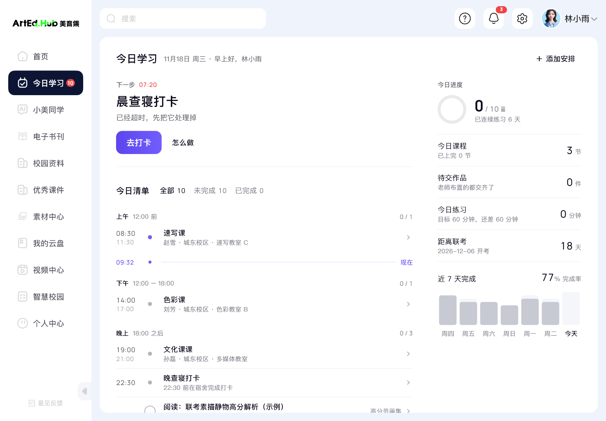

# 新页面设计语言

美术新增页面共用的一套版式、组件和数值。2026-11-18 定为「留白」方向：一整张白色底板，靠字号、间距和细线分区，不用卡片。

- **管哪些页面**：今日、电子书刊、素材中心、优秀课件、集市、学情、教学报告、作品、画室工具箱。保留页面（首页、小美同学、智慧校园等）和外壳不归它管，见 `AGENTS.md`。
- **和别的文档的关系**：通用令牌（颜色值、字阶、间距刻度）和已有组件的用法以 [设计规范](设计规范.md) 为准。两者对新页面说法不同的地方（选中态的颜色、切换和筛选用哪个组件、卡片、详情页标题字号），新页面以本文为准。`AGENTS.md` 里「品牌紫只用于主操作、选中态和关键数字」是上限，不是每个选中态都要用紫。怎么评、怎么判断在 `.cursor/skills/ui-partner/taste.md`。
- **组件**：都在 `lib/core/ui`，从 `ui.dart` 引入。演示页 `/design-system` 最上面一节「新页面组件」是它们拼在一起的样子。

## 示例屏

选方向时做的两张稿，今日和电子书刊的首屏。它们是这套语言的样板，重构其他页面时拿来对照。稿子的代码在提交 `fe661e5` 的 `lib/features/design_system/directions/direction_a.dart` 和 `direction_kit.dart` 里，重构这两页时可以取用。

1024×768 的版本在同一目录下：`today-1024.png`、`ebooks-1024.png`。

## 一、三条总则

1. **画是主角。** 作品、范画、封面周围只有白色和中性灰，图上不压东西。
2. **一屏一个重点。** 一个主按钮，一处 24 号的重点标题，其余都退后。
3. **不用卡片。** 分区靠留白，行与行之间靠细线。容器最多两层，外壳给的白色底板不算。

## 二、页面骨架

| 项 | 做法 |
| --- | --- |
| 底板 | 外壳给的整块白色底板。页面的路由不放进 `shell_scaffold.dart` 的 `_routesWithOwnSurface`，页面自己也不再包 `ShellPageSurface` |
| 内容区 | `AppPageBody`：左右边距宽屏 32、窄屏 24，页头上方留 20，底部留 32 |
| 滚动 | 一般整页一起滚动，页头和筛选跟着走。要下拉刷新、分页加载时用 `AppPageBody.slivers`。画布加面板的页面不整页滚动（见第八节） |
| 宽窄 | 内容区宽度不小于 900 算宽屏（1180×820），否则窄屏（1024×768） |
| 两栏 | 主栏自适应，侧栏宽屏 280、窄屏 232，栏间距宽屏 48、窄屏 32。主栏放用户来做的事，侧栏放辅助的数字和图 |
| 首屏 | 用户来看、来做的内容从屏高四成以内开始 |
| 沉浸页 | 阅读器、原卷查看、范画对比、全屏看画不带外壳，见第九节 |

## 三、页头

`AppTitleBar`，高 44，所有新页面同一个位置。

- **名称**：20 号粗体，看得见。和导航或入口上的叫法一致；对不上时请 Gary 定。
- **视图切换**：`AppViewTabs`，紧跟在名称右边。
- **说明**：13 号，一行，放日期、范围这类上下文。有视图切换时可以不写。
- **操作**：靠右，从左到右是搜索框、排序、次要操作、主按钮。主按钮最多一个（`AppButton`），其余用 `AppPlainButton`，只有图标的用 `AppIconAction`。搜索框宽屏 260、窄屏 220。
- **详情页**：`AppTitleBar(onBack: …)`，左边是返回（`AppBackButton`，点击区域 44），名称是对象的名字（书名、作品名），仍是 20 号，太长时省略成一行。本文第十节说的 24 号重点标题是内容里的，不是页头。
- **从别处带参数进来的一级页**（例如从首页科目卡进素材中心）：页头左边也有返回，名称不变。
- 返回按钮按本页下面有没有页面决定显示（`ModalRoute.of(context)?.canPop`），不用 `Navigator.canPop()`，否则打开菜单时页头会误冒出返回。
- 详情页的对象名只在页头出现一次，内容里不再用 24 号重复。非画布类详情的主栏是封面（宽屏 168、窄屏 136）加不超过三行出处，侧栏放相关内容的小封面行（48 宽）。

## 四、分区

- 分区之间留 24，中间画一条 `AppRule`。同一分区里的小块之间留 16。
- 分区标题用 `AppSectionTitle`：16 号粗体，后面跟一句 12 号的数量或口径，右边可以放一个次要操作或一组小切换。
- 并排的两块之间用 `AppRule.vertical`，不用两个卡片。
- 什么时候可以用带底色的容器：图片和画布的底（`AppColors.canvas`）、输入框、浮层。普通内容不包。
- **「接着做」条**：列表页首屏可以有一条，提出用户上次没做完的那一件（电子书刊的「接着读」）。72 宽小封面、12 号标签、16 号名称、进度和这一屏唯一的主按钮；右侧 `AppRule.vertical` 之后可以放两条推荐。有筛选或搜索时隐藏。

## 五、切换与筛选

同一件事只用下面这一种做法。

| 事 | 组件 | 样子 |
| --- | --- | --- |
| 切换视图（书库 / 我的书架） | `AppViewTabs` | 文字，选中的是墨色粗体加下划线 |
| 分区里的小切换（全部 / 未完成 / 已完成） | `AppViewTabs(dense: true)` | 14 号文字，靠粗细和颜色区分，可带数量 |
| 筛选（分类、科目、状态） | `AppFilterBar` | 一行文字，选中的垫浅灰胶囊，放不下时横向滑动 |
| 第二级筛选（科目下的题材） | `AppViewTabs(dense: true)`，放在列表的分区标题那一行右边 | 和第一级长得不一样，一眼看出谁管谁 |
| 排序 | `AppPlainButton` 写出当前排序方式，点开 `showAppMenu(selected: 当前值)` | 菜单里当前项粗体加墨色对勾 |
| 搜索 | `AppSearchField` | 一页只有一个页内搜索 |

- 选中状态一律不用品牌紫，也不用深色实底。切换视图不用主按钮。
- 两级筛选的「全部」只出现在第一级；第二级的第一项写「全部题材」这类带范围的叫法，或者写本科目的名字。
- 搜索没有结果时，空状态说「没有找到与『某某』相关的…」，操作是「清除搜索」；筛选后没有结果才说「换个科目或分类看看」。

## 六、列表与表格

- 行高不小于 56，行与行之间一条 `AppRule`。
- 整行可点，行尾一个浅灰的箭头。行里不放按钮；只有一屏里最要紧的那一件事单独提出来，配主按钮。
- 每行都有的一个小操作（收藏、移出书架）用 `AppIconAction`，放在行尾箭头的位置，这一行就不再整行可点以外另放按钮。
- 行的结构从左到右：时间或序号（44 宽，没有就空着，保持对齐）、状态标记、名称和一到两行说明、右侧的短标注、箭头。
- 状态标记：要本人打勾的是 22 的圆圈，跟着业务数据自动变化的是 8 的圆点。完成是绿色实心加对勾，进行中是品牌紫，超时是红色，其余是灰色。
- 说明最多两行，不截成一行。
- 同一件事在一屏里只出现一次：提到上面的那件事，不在下面的列表里再列一遍。
- **表格**用 `AppDataTable`：没有外框和底色，表头是 12 号三级文字，行高不小于 48，行间细线；数字列右对齐、用数字字体；需要先看的一行（本人、本次）用 `emphasis` 加粗，不换底色；整行可点时行尾有箭头。
- 表格或列表整行可点、打开的是这一行对象的详情时（学情里点一科打开原卷），分区标题后面那句说明写清点了去哪（「点一科查看原卷」），行里不再放按钮。
- **目录 / 章节列表**：44 宽页码列、名称、箭头，行高 56。当前项加粗并写「读到这里」「正在看」，不用紫。
- 列表里每行都可能处于的状态（已收藏）用实心图标表示，颜色用墨色（`AppIconAction(activeColor: AppColors.ink)`）。详情页只有一个时才用品牌紫。

## 七、图片与网格

- 比例统一的图（书刊封面 3:4）用 `AppTileGrid`：宽屏 5 列、窄屏 4 列。
- 比例不一的画（范画、作品墙）用 `AppMasonryGrid` 按原比例排：宽屏 4 列、窄屏 3 列。
- 间距宽屏 28、窄屏 24（`AppPageBody.tileGap`）。
- 每一格用 `AppImageTile`：图在上，名称 14 号中粗给两行，说明 12 号一行。没有卡片底。
- 图片用 `AppImageTile.frame` 包一层：圆角 6，一圈 1 像素的细描边。白纸上的素描在白色底板上要靠这圈描边。
- 图上不压任何标签和按钮。阶段、来源、档位、状态、进度都写在说明那一行；每一格都有的小操作（收藏）放在名称右边（`AppImageTile.action`），不放在图上。
- 说明那一行写「来源 · 作者」这类区分作品的信息，浏览量这类数字不放进格子。说明里的数字随文字用正文字体，不单独换数字字体。
- 尽量按原比例显示。必须统一比例时（封面 3:4），不能裁掉头、脚这类关键部位。小缩略图（相关作品、目录）也一样，宁可留白不裁。
- 进行中的状态（正在读、待处理）可以把说明那一行换成 `brandDeep`，一屏不超过一处。
- 列表末尾「已显示全部 N 幅」用三级文字色。

## 八、画布加面板

看一张画、用一个工具、看原卷的页面都用 `AppCanvasLayout`，放在 `AppPageBody(scrollable: false)` 里、页头下面。

- **画布**在左，`AppColors.canvas` 的中性浅灰底，圆角 8，占满页头以下的高度，不随面板滚动。画完整显示（`BoxFit.contain`），可以原位缩放。
- 画上不压文字和按钮。操作提示（「双指缩放 · 双击放大」）和画布自己的小操作（全屏、复位、旋转）放在画布下面一行（`hint`、`canvasActions`）。
- **面板**在右，宽屏 280、窄屏 232，内容多时自己滚动。工具的设置面板需要更宽时可以用 320 / 280。
- 面板从上到下：一行出处（来源 · 作者 · 单位，或档位和分数）；用户能照着做的内容（点评要点、临摹建议、工具设置）；说明；标签；`AppRule` 之后是相关内容。
- 面板里的分区同第四节，用 `AppSectionTitle`，不包灰底块。
- 页头放这一屏会产生结果的唯一主按钮（对比我的原卷、开始练习），其余是 `AppPlainButton`。
- 画布里只有一张图时，名称写在画布顶部一行；并排两张时，各自的名称紧贴在画的正上方。
- 设置面板里的选项组用筛选胶囊样式等宽换行；开关打开是墨色（`AppSwitch(activeColor: AppColors.ink)`），滑条已选段是墨色。
- 没有图片的工具（人体比例图示、表单类）把画布改成白底（`canvasColor: AppColors.surface`），不套一块空的灰画布。
- 有说明要读的沉浸页（看原卷）也用画布加面板；切到对照时面板收起，两张图并排。

## 九、沉浸页与对比

阅读器、原卷查看、范画对比、全屏看画不带外壳，占满整屏。

- **顶栏**：白底，高 64，左右边距 24，里面是 `AppTitleBar(onBack: …)`，下面一条 `AppRule`。模式切换（并排 / 滑动、彩色 / 灰度）用 `AppViewTabs`，靠右放；没有主按钮时整屏不用品牌紫。
- **底色**：看画、对比用 `AppColors.canvas`；长时间阅读、看原卷可以用 `AppColors.canvasDark`。都不带色相。
- **对比**：两张画按同样的高度显示，大小可比；各自的名称写在画的上方一行，不压在画上。分隔条可以拖动，双击复位。
- 全屏看画（点大图放大）用不透明的 `canvasDark` 底，看不到下面的页面。
- 顶栏里有两组模式切换时，中间放一条 20 高的短竖线（`AppRule.vertical(gap: 33)`），不然读起来像一组四个页签。
- **阅读器底栏**：缩略图 40×53，点击区域 48，页码写在图下；当前页 2 像素墨色描边；进度条用中性色。

## 十、数字与图表

- 几个并列的数用 `AppStatRow` 上下排开，中间 `AppRule`：左边名称和一句说明，右边 20 号数字加单位。不用带图标底座的数字卡，数字不带颜色。
- 一屏最多一个 32 号的大数字（`AppText.displayNumber`），给这一页最关键的那个数。
- 整体进度用 `AppProgressRing`，一屏最多一个。
- 同一个数在一屏里只出现一次。
- 图表沿用 `AGENTS.md` 里今日的图表规则，推广到所有新页面：
  - 一个系列一种品牌紫，非重点的用中性灰，重点（今天、最新）才用紫。
  - 绿、琥珀、红只表示状态，旁边带文字。
  - 不用饼图、环形图和双轴；纵轴从 0 起；数值直接标在图上。
  - 柱状图和折线图提供数据表视图和读屏文字；FL Chart 用 `duration: Duration.zero`。
  - 折线用中性灰，只有最新一点用品牌紫，每个点标数；名次图纵轴从第 1 名起，越靠上越好。点上的标注里数字用数字字体，汉字用正文字体（数字字体里没有汉字，会显示成方块）。学情的 `student_line_chart.dart` 是现成的写法。
- 图表不包卡片，上面一行是标题和结论数字。

## 十一、颜色

- **品牌紫**一屏不超过三处：主按钮、对象本身的进行中状态（正在读、当前步骤、已收藏）、一处关键数字。控件的选中态（页签、筛选、菜单）不用紫。数法见 `taste.md`。
- **状态色**绿、琥珀、红只表示状态，并且有文字。超时这类事一屏只用一处红色。
- **科目色**只用在科目标签上（`AppTag.subject`），不写大数字、不画进度条。美术常识、文化课这类其他科目用 `AppTag.subject(name, otherNeutral: true)`，显示中性灰，不占品牌紫。
- **文字**：一级墨色，说明用二级，辅助信息用三级。用户要读的字不用占位灰。
- **底色**：作品和画布背后用 `AppColors.canvas`、`AppColors.canvasDark`，不用带蓝的 `surfaceSubtle` 和 `page`。
- 不用的东西：渐变头图、彩色图标底座、浅紫底的卡片和标签成片出现、深色实底的按钮和选中态。

## 十二、文字

| 用途 | 样式 |
| --- | --- |
| 页头名称（含详情页的对象名） | `title20` |
| 内容里一屏一处的重点标题（下一步、考试名、总分旁的标题） | `title24`，一屏一处 |
| 分区标题 | `title16` |
| 行和格子的名称 | `body14Strong` |
| 正文 | `body14` |
| 说明 | `body13` 或 `caption12` |
| 数字 | `AppText.number`；大数字 `AppText.displayNumber` |

- 字号只有 12 / 13 / 14 / 16 / 20 / 24 / 32。
- 名称给两行，说明给一到两行。放不下时先减内容或换版式，最后才截断。
- 同一个东西前后叫法一致。

## 十三、按钮与点击

- 一屏一个主按钮：`AppButton`。它给会产生结果的那个动作。放在页头里时高 44，和页头一样高。
- 次要操作用 `AppPlainButton`：墨色文字，44 高，按内容取宽。左右各 12 的内距是点击区域；要让文字和正文或右边缘对齐，外面用 `Transform.translate` 抵消 12。可见文字太短时用 `semanticLabel` 给完整读屏名称，要包含可见文字（「目录」读作「目录与书签」）。只有图标的用 `AppIconAction`（44 见方，有读屏名称和悬停提示）；返回用 `AppBackButton`。
- 危险操作用 `AppButton(variant: danger)`，先 `showAppConfirm(danger: true)`。
- 行、格子、主按钮、页签、筛选项、图标操作的点击区域宽高都不小于 44。看得见的部分可以小一些，例如筛选胶囊看上去高 36。
- 一排一样的按钮改成整行或整格可点。
- 点击没有动画；只有浮层淡入，不超过 200 毫秒。

## 十四、表单

- 单列，标签在输入框上面，用 `AppInputField`、`AppSelect`。每个字段都有名称，下拉框也不例外。
- 分组用 `AppSectionTitle` 加 `AppRule`，不用卡片。
- 必填统一用红色星号；可选的不标。
- 主按钮在页头右侧。离开前有没保存的内容要确认。
- 弹窗和抽屉沿用 `showAppDialog`、`showAppDrawer`；长表单用整页或抽屉，不用弹窗。

## 十五、加载、空、出错

- 加载：首屏用和最终版式同尺寸的 `AppSkeleton`，或者居中的 `AppLoadingIndicator`。切换筛选时保留旧内容，上面盖一层 `AppLoadingOverlay`。
- 空：`AppEmptyState`，说清这里会有什么、怎么让它出现，最多一个操作。一条数据都没有时，筛选项和搜索框不必显示。
- 出错：`AppErrorState` 加「重试」。没有权限不是加载失败，要说明原因并给出能去的地方。
- 三种状态和正常状态占同样的位置。

## 十六、组件清单

| 组件 | 文件 | 用途 |
| --- | --- | --- |
| `AppPageBody` | `app_page_body.dart` | 内容区的边距、滚动和宽窄判断；`AppPageBody.slivers` 用于刷新和分页 |
| `AppTitleBar`、`AppBackButton`、`AppIconAction` | `app_title_bar.dart` | 页头、返回、只有图标的操作 |
| `AppViewTabs` | `app_view_tabs.dart` | 视图切换、分区里的小切换、第二级筛选 |
| `AppFilterBar` | `app_filter_bar.dart` | 筛选条 |
| `AppPlainButton` | `app_plain_button.dart` | 次要操作 |
| `AppRule` | `app_rule.dart` | 细线 |
| `AppSectionTitle` | `app_section_title.dart` | 分区标题 |
| `AppStatRow` | `app_stat_row.dart` | 一个数 |
| `AppProgressRing` | `app_progress_ring.dart` | 进度环 |
| `AppImageTile`、`AppTileGrid`、`AppMasonryGrid` | `app_image_tile.dart` | 图片格子、等比网格、瀑布流 |
| `AppCanvasLayout` | `app_canvas_layout.dart` | 画布加面板 |
| `AppDataTable` | `app_data_table.dart` | 表格 |
| `AppColors.canvas`、`AppColors.canvasDark` | `app_colors.dart` | 画和画布背后的中性底 |

继续使用的已有组件：`AppButton`、`AppSearchField`、`AppInputField`、`AppSelect`、`AppTag`、`AppStatusTag`、`AppImage`、`AppAvatar`、`AppProgressBar`、`AppEmptyState`、`AppErrorState`、`AppSkeleton`、`AppLoadingIndicator`、`AppLoadingOverlay`、`showAppMenu`、各种浮层和轻提示。

新页面不再使用：`AppCard` 包普通内容、`AppSegmented` 和 `AppChip` 做切换与筛选、`AppTabs`、`AppStatTile`、`AppPageHeader`（它不显示标题）、带底色的 `AppIconButton`（改用 `AppIconAction`）、`AppListRow`（行按第六节自己排）、`gallery/ui/widgets/library_controls.dart` 里的那一套控件、`today_style.dart` 里的彩色图标底座。这些组件本身不删不改，保留页面还在用。

## 十七、要新增做法的时候

这份文档没有覆盖到的版式（时间线的细节等），在重构到那个页面时补进来：

1. 先看能不能用上面已有的做法拼出来。
2. 不能时提出新的做法，说明它还会用在哪些页面，渲染出来给 Gary 看。
3. 定下来后写进本文对应的一节；做成共享组件的，加进 `lib/core/ui`、组件清单和演示页。
